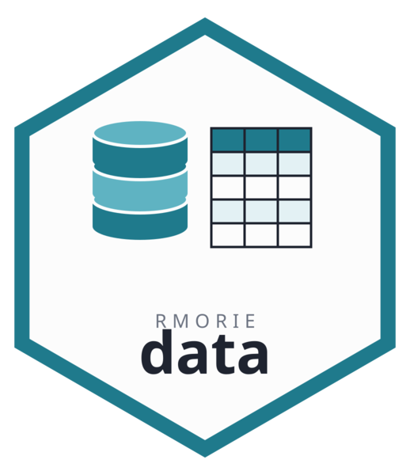

# rmoriedata 

<!-- badges: start -->
[](https://CRAN.R-project.org/package=rmoriedata)
[](https://cran.r-project.org/package=rmoriedata)
[](https://github.com/rootcoder007/rmoriedata/actions/workflows/R-CMD-check.yaml)
[](https://rootcoder007.r-universe.dev/rmoriedata)
[](https://spdx.org/licenses/AGPL-3.0-or-later.html)
<!-- badges: end -->

Integrated open-data fixtures for [rmorie](https://github.com/rootcoder007/rmorie),
plus a small set of base-R helpers. Its core job remains the `inst/extdata/`
files used by `rmorie`'s examples, vignettes, and tests.

## Install

Install the current release from r-universe (prebuilt binaries for macOS and
Windows), which can be newer than CRAN. rmoriebricklayer, its companion, is
named too, so an older copy already installed is replaced: rmoriedata needs
rmoriebricklayer 1.0.0 or later.

With [pak](https://pak.r-lib.org) (progress bars, parallel downloads, compiler
output hidden unless a build fails, and the named packages always upgraded to
the current release). Keep the `repos` arguments as written: under `Rscript`
there is no mirror chooser, so a bare `install.packages()` stops with "trying to
use CRAN without setting a mirror", and CRAN can carry older versions than
r-universe.

```r
if (!requireNamespace("pak", quietly = TRUE)) {
  install.packages("pak", repos = "https://cloud.r-project.org")
}
pak::repo_add(rootcoder007 = "https://rootcoder007.r-universe.dev")
pak::pkg_install(c("rmoriebricklayer", "rmoriedata"))
```

From a terminal (single quotes outside, double quotes inside, so the shell
passes the R code through untouched):

```sh
Rscript -e 'if (!requireNamespace("pak", quietly = TRUE)) install.packages("pak", repos = "https://cloud.r-project.org"); pak::repo_add(rootcoder007 = "https://rootcoder007.r-universe.dev"); pak::pkg_install(c("rmoriebricklayer", "rmoriedata"))'
```

Without pak, plain `install.packages()` does the same with R's own output:

```sh
Rscript -e 'install.packages(c("rmoriebricklayer", "rmoriedata"), repos = c("https://rootcoder007.r-universe.dev", "https://cloud.r-project.org"))'
```

Development version from GitHub (a source build; needs a C/C++ toolchain):

```sh
Rscript -e 'if (!requireNamespace("pak", quietly = TRUE)) install.packages("pak", repos = "https://cloud.r-project.org"); pak::repo_add(rootcoder007 = "https://rootcoder007.r-universe.dev"); pak::pkg_install("rootcoder007/rmoriedata")'
# without pak
Rscript -e 'repos <- c("https://rootcoder007.r-universe.dev", "https://cloud.r-project.org"); install.packages("remotes", repos = repos); remotes::install_github("rootcoder007/rmoriedata", repos = repos, upgrade = "always")'
```

On macOS, CRAN's R (from <https://CRAN.R-project.org/bin/macosx/>) installs
r-universe's prebuilt binaries in seconds. Homebrew's R cannot use them, so
there every package is compiled from source.

## Curated tables at data.rmorie.com

The 175 databases (716 tables on 2026-10-13) the MORIE project materialises from
BigQuery public datasets and the survey, court and justice data its ledger uses are served
from the edge and opened by the MORIE key: `hostlogin()` signs in with GitHub or
an emailed code, or ask at `www.rmorie.com/access/`; the terms are at
`www.rmorie.com/data-license/`. The ICPSR, NCVS 38604 and a2aj tables open once you
accept their terms at `data.rmorie.com/terms`. rmoriedata is
self-sufficient: store the key once, then load any `db/table` key. The endpoint comes from a
signed services document the packages verify before use, so it can change without a release.

```r
hostlogin(token = "...")         # the key from rmorie.com/access; login() (GitHub) and login(email = ) still work
cat_ <- hostcat()            # key, rows, columns, source dataset
df <- hostload("fec_cm_2020/fec_cm_2020")
```

The key lands in the credentials file that rmorie, morie and
rmoriebricklayer read too, so one key serves every MORIE package. It opens
the tables only; it is never a language model.

## Asking a language model

`ask()` puts a question about the datasets to a language model you bring: a
provider's key (OpenAI, Anthropic, Google Gemini, OpenRouter, Groq, Mistral and
more, each from its usual variable), an Ollama server, or an OpenAI-compatible
server of your own. The model gets the catalogue and every function of
rmoriedata and rmoriebricklayer, with tools to read their help.

```r
Sys.setenv(ANTHROPIC_API_KEY = "...")          # or mdllmconf(anthropic.key = "...")
ask("which tables cover police stops?")
ask("which tables cover police stops?", route = "ollama", model = "qwen3:8b")
```

## Quick start

```r
library(rmoriedata)

# Browse and load a bundled table by slug.
cat <- mdcat()
head(cat[cat$kind == "table", c("slug", "n_rows", "n_cols")])
iucr <- mdload("chicago_iucr_codes")

# Release a private count, then check a table for re-identification risk.
dplapcnt(true_count = 42, epsilon = 1.0)
df <- data.frame(age = c(25, 25, 25, 40), sex = c("F", "F", "F", "M"))
kanonvrf(df, c("age", "sex"), k = 2)$summary
```

See `vignette("rmoriedata")` for the full tour.

## Functions

A small, deliberate set of base-R helpers (the bulk of the package is still data):

- **Data access** — `mdcat()`, `mdload()`,
  `mddict()`, `mdsums()`; `mdverify()`
  checks every bundled file against the signed manifest.
- **Ontario SIU director's reports** — `siuload()` returns the reviewed
  corpus (one row per report, French and English, with corrigenda applied).
- **CIHI data tables** — `cihitbls()` lists the open workbooks and
  `cihiget()` downloads one (live, with a Wayback fallback).
- **Chicago** — `chiload()` (below) and `chiclr()` for the
  cached full datasets.
- **Differential privacy + re-identification risk** — `dplapcnt()`,
  `dpgmean()`, `dplaphist()`,
  `cellsupp()`, `kanonvrf()`, `ldivvrf()`;
  `dpbudget()` holds an epsilon (and delta) the releases draw down, and
  `dpspent()` reports what has been spent.
- **Shared compiled core** — `mdsha()` and `mdmean()` delegate
  to the family's C core via `LinkingTo: rmoriebricklayer` (one source of truth).

## Chicago sample data — R and Python

Bundled samples (`complaint_sample`, `arrest_sample`) from the City of Chicago
open data; the full datasets are fetched on demand and cached.

```r
library(rmoriedata)
data(complaint_sample)                       # bundled sample, offline
crimes <- chiload("complaints", full = TRUE, limit = 200)  # the full data, first 200 rows
# omit `limit` for the whole multi-million-row dataset (large: minutes and gigabytes)
pq <- chiload("arrests", as = "parquet_path")  # Parquet for Python
```

```python
import pandas as pd
df = pd.read_parquet(pq)                      # path printed by chiload

# Or read the bundled .rda directly (no R install) — use the date_iso column,
# since POSIXct does not roundtrip cleanly through pyreadr:
import pyreadr
complaints = pyreadr.read_r("rmoriedata/data/complaint_sample.rda")["complaint_sample"]
```

Every bundled table also ships as Parquet: `mdpath("<slug>")` gives
the verified path, `pd.read_parquet()` reads it.

**Recommended Python bridge:** the Parquet path (`as = "parquet_path"`) — typed,
columnar, read natively by pandas/polars/duckdb with correct timestamps and no R
runtime. `pyreadr` on the `.rda` works for quick read-only access but is slower
and mangles `POSIXct` (use `date_iso`).

## Why a separate package?

CRAN packages have a 5 MB soft-cap on source tarball size. `rmorie`'s
~6.4 MB of integrated fixtures would push it over that threshold and trigger
a reviewer pushback. Splitting the data out keeps `rmorie` lean
(~few hundred KB of code) and lets data ship at any size via r-universe.

## Citation

If you use rmoriedata in your research, please cite the software:

> Ruhela, V. S. (2026). *rmoriedata: Integrated Datasets for the rmorie Package.* R package version 0.4.0. doi:10.32614/CRAN.package.rmoriedata. https://rootcoder007.r-universe.dev/rmoriedata

BibTeX (or run `citation("rmoriedata")` after installation for the entry
stamped with the exact installed version, sourced from `inst/CITATION`):

```bibtex
@Manual{ruhela_rmoriedata_2026,
  title  = {rmoriedata: Integrated Datasets for the rmorie Package},
  author = {Ruhela, Vansh Singh},
  year   = {2026},
  doi    = {10.32614/CRAN.package.rmoriedata},
  url    = {https://rootcoder007.r-universe.dev/rmoriedata}
}
```

See [`CITATION.cff`](https://github.com/rootcoder007/rmoriedata/blob/main/CITATION.cff) for the
machine-readable metadata GitHub's "Cite this repository" button uses.

## License

AGPL-3.0-or-later. The fixtures themselves are public-domain or
under permissive open-data licenses from their source portals; see
the per-file headers in `inst/extdata/` for attribution.
